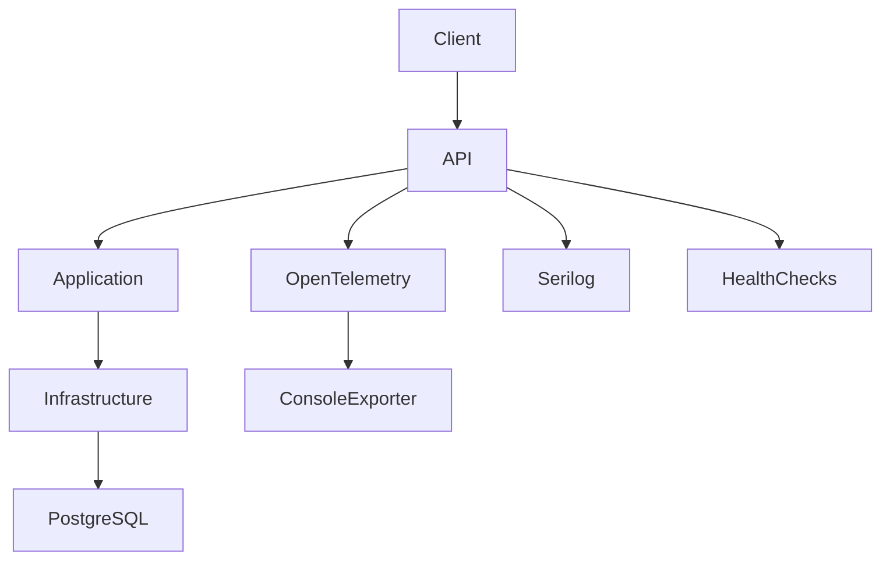

# System Design Document

## 1. Architecture diagram

## 2. Component roles

- **Client / Test Harness**: Sends HTTP requests or runs unit/integration tests.
- **API Layer (Controllers)**: Receives requests, validates models, delegates to application services, and returns HTTP responses.
- **Application Services (BookingService, AvailabilityService)**: Contains business logic, uses `SchedulerDbContext` for database access, and applies domain rules.
- **Domain Models**: Immutable records representing entities such as `Appointment`, `Dealership`, `ServiceBay`, etc.
- **Infrastructure**: Database context, entity‑framework configurations, exception handling, correlation ID middleware, metrics, and OpenTelemetry integration.
- **PostgreSQL**: Stores all domain data; used by both application services and health checks.
- **Observability**: Serilog for structured logging, OpenTelemetry for distributed tracing, and custom metrics via `SchedulerMetrics`.
- **Health Checks**: Liveness (`/health`) and readiness (`/health/ready`) endpoints for Kubernetes/Docker readiness probes.

## 3. Data flow for `POST /api/appointments`

1. **Controller** receives `BookingRequest` and calls `BookingService.BookAsync`.
2. **BookingService** validates IDs, parses `StartTime`, checks vehicle/dealership/service type existence.
3. **TimeWindow** is created; `BookingRules.HasStarted` rejects past times.
4. **Working‑hours check** via `BookingRules.IsWithinWorkingHours`.
5. **Vehicle‑already‑booked check** ensures no overlapping appointments for the same vehicle.
6. **Serializable transaction** selects a free bay and a free technician (based on skill and overlapping appointments).
7. **Insert** the new `Appointment` and commit.
8. **Metrics** record confirmation, conflict reason, and duration.
9. **Logs** record request, confirmation (with IDs), or rejection (with code).
10. **Controller** returns 201 Created with  `AppointmentResponse`.

## 4. Technology choices

- **.NET 10**: Modern, supported runtime with built‑in performance improvements.
- **PostgreSQL + Npgsql**: Relational DB with strong JSON support and ACID guarantees.
- **Entity Framework Core**: Data access with configuration via Fluent API.
- **Serilog + RenderedCompactJsonFormatter**: Structured, console‑friendly logging.
- **OpenTelemetry + Console Exporter**: Distributed tracing and metrics for observability.
- **xUnit**: Lightweight unit‑test framework.
- **WebApplicationFactory**: Isolated integra
## 5. Concurrency strategy

- **Serializable transaction** in `BookingService` retries up to three times on PostgreSQL serialization failures.
- **Exclusion constraints** via unique indexes on `(ServiceBayId, StartUtc, EndUtc)` and `(TechnicianId, StartUtc, EndUtc)` prevent duplicate bookings at the DB level.
- **Vehicle‑already‑booked check** ensures no overlapping appointments for the same vehicle.

## 6. Observability strategy

- **Logs**: Serilog enriches logs with correlation ID, request path, and booking details.
- **Metrics**: `appointments_confirmed_total`, `booking_conflicts_total` (tagged by reason), `booking_duration_ms`.
- **Traces**: OpenTelemetry instruments ASP.NET Core, HttpClient, and Npgsql.
- **Health checks**: `/health` (always healthy) and `/health/ready` (checks DB connection).

## 7. Scalability and reliability

- **Stateless API**: Behind a load balancer; each request is independent.
- **Read replicas**: Availability queries could be directed to a read replica for lower latency.
- **Short‑lived caching**: In‑memory cache for dealership hours and service types (not implemented yet).
- **Idempotency keys**: Not implemented; retries are safe due to serializable transactions.
- **Outbox pattern**: Not implemented; notifications are synchronous.

- **Assumptions**: UTC dealership time zone, fixed working hours, seeded data IDs, no authentication.
- **Future work**: Add authentication/authorization, reschedule/cancellation endpoints, multi‑bay jobs, technician shift management, outbox for notifications, caching, load testing, CI/CD pipeline.

## 9. How I used GenAI in the design phase

- **API contract design**: Defined request/response models, validation rules, and error handling patterns.
- **Business logic implementation**: Built the booking service with serializable transactions, availability queries, and conflict detection.
- **Observability setup**: Configured Serilog, OpenTelemetry, metrics, and correlation IDs.
- **Test coverage**: Created unit tests for domain logic and integration tests that exercise the full stack against a local PostgreSQL instance.
- **Documentation**: Produced a detailed README and system‑design document covering architecture, data flow, technology choices, and future work.

The AI helped ensure the solution was production‑ready, well‑tested, and documented, while I guided the design to match the original requirements and clarified ambiguous points.